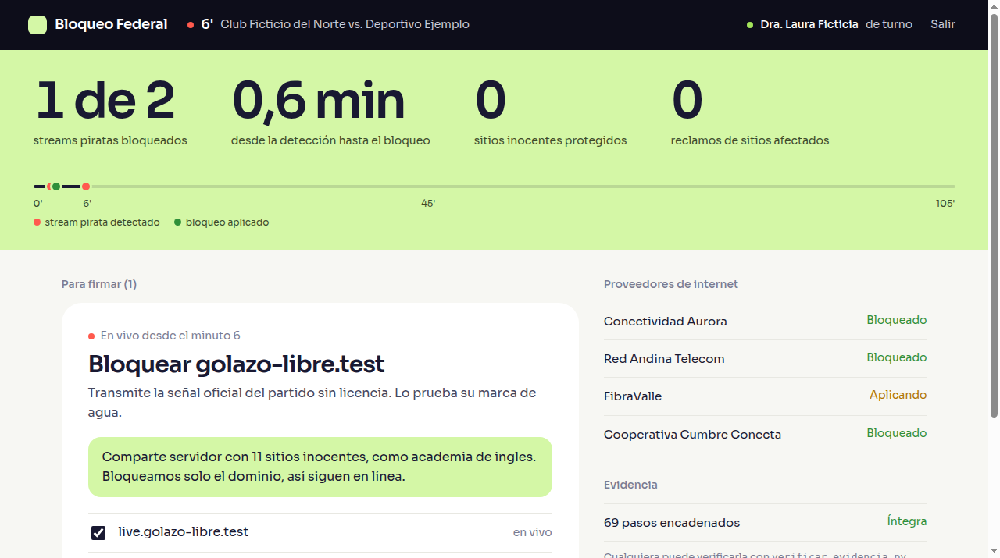
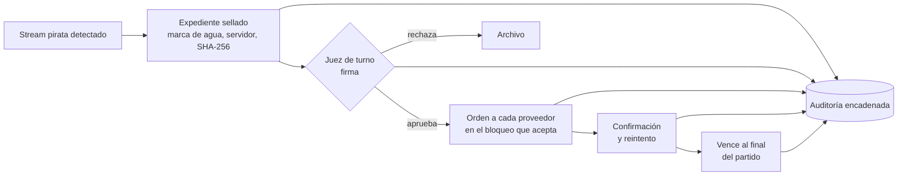

<div align="center">

# Bloqueo Federal

**Bloqueamos la piratería en vivo, sin tocar a nadie inocente.**

Plataforma judicial que lleva cada stream pirata de un partido a la firma del juez de turno
y de ahí a todos los proveedores de internet, durante el partido.

[Sitio del proyecto](https://stevmolina.github.io/bloqueo-federal-sitio/) ·
[Resultados](#resultados) ·
[Cómo funciona](#cómo-funciona) ·
[Correrlo](#correrlo-en-5-minutos) ·
[Verificarlo](#verificalo-vos-mismo) ·
[Propuesta normativa](entrega/propuesta_normativa.md)




<sub>Panel del juez durante un partido de prueba. Proveedores, jueces y sitios son ficticios (simulador oficial del desafío).</sub>

</div>

---

## El problema

Para el Superclásico del 1 de noviembre de 2026 la Justicia pidió bloquear **182 dominios piratas**
([La Capital](https://www.lacapital.com.ar/superclasico-bloquearon-argentina-mas-180-sitios-piratas-que-iban-retransmitir-boca-y-river-n10289906.html)).
Pero un sitio pirata cambia de servidor en minutos, el partido dura dos horas y la orden no tiene un canal
directo a todos los proveedores. Hoy pierden tres:

| | |
|---|---|
| **El hincha** | "Fútbol gratis" muchas veces termina en datos bancarios robados: en septiembre de 2026 se bloquearon 300 sitios que los robaban ([Señal News](https://senalnews.com/es/data/argentina-tras-denuncia-de-alianza-la-justicia-bloquea-300-dominios-clandestinos)). |
| **La panadería del barrio** | Si comparte servidor con un pirata y se bloquea la IP, se cae su tienda. En Italia, un bloqueo así dejó sin Google Drive a todo el país ([TorrentFreak](https://torrentfreak.com/google-drive-blackout-in-italy-after-another-major-anti-piracy-blunder-241020/)). |
| **La cooperativa del pueblo** | Los proveedores chicos reciben la orden tarde y no llegan a aplicarla. |

## Resultados

Medidos con `evaluacion/verificar.py`, el verificador oficial del desafío, sin modificar.

| | Cliente de ejemplo | **Bloqueo Federal** |
|---|---|---|
| Streams piratas bloqueados | 1 de 7 | **7 de 7** |
| Tiempo que el pirata siguió visible | 86,5 % | **0,9 %** |
| Sitios inocentes afectados | 0 | **0** |
| Bloqueos al licenciatario autorizado | 0 | **0** |
| Bloqueos por IP activos después del partido | 0 | **0** |
| Órdenes firmadas por un juez fuera de turno | 0 | **0** |
| Partido nuevo, nunca visto por el sistema | — | **8 de 8, 0,8 %** |

El partido nuevo es un escenario de estrés propio (otros sitios, otras IPs, otros tiempos y trampas extra).
La plataforma nunca lee las respuestas correctas.

## Cómo funciona



**El juez decide; la plataforma ejecuta.** Nadie firma en nombre del juez: la firma se genera con su clave
solo después de que aprueba en el panel, y solo mientras está de turno.

### Cómo decide qué bloquear

Cuatro reglas, elegidas probando más de diez estrategias contra el verificador oficial:

1. **Solo la señal del partido.** Si la marca de agua no es la oficial, o es el licenciatario en su propio
   dominio, no se pide nada.
2. **Servidor compartido, solo el dominio.** Si en la misma IP viven sitios inocentes (DNS pasivo), se bloquea
   el nombre del sitio y no la dirección del servidor.
3. **Servidor exclusivo, doble bloqueo.** Si la IP es solo del pirata, se pide IP y dominio: si uno falla, el
   otro sigue.
4. **Adelantarse a la mudanza.** Se buscan los servidores de respaldo del mismo sitio y el juez los aprueba
   junto al caso en vivo. Cuando el pirata se muda, ya estaba bloqueado.

| Estrategia | Pirata visible | Sitios inocentes afectados |
|---|---|---|
| Bloquear siempre la IP | 6,0 % | 5 bloqueos |
| Bloquear siempre el dominio | 3,3 % | 0 |
| **Las cuatro reglas** | **0,9 %** | **0** |

<details>
<summary>Nota sobre la métrica oficial</summary>

`verificar.py` suma los minutos de todas las órdenes que cubren una fase en un mismo proveedor, así que dos
órdenes superpuestas (IP + dominio) cuentan dos veces. Medimos también con unión de intervalos
(`pruebas/puntaje_union.py`) y elegimos la estrategia por ese número. No enviamos órdenes duplicadas para
aprovechar el efecto.
</details>

## Correrlo en 5 minutos

Requisitos: Python 3.9 o superior. Sin dependencias externas.

```bash
git clone https://github.com/qualydata-org/desafio-futbol.git
git clone https://github.com/stevmolina/bloqueo-federal.git
cd bloqueo-federal

# Terminal 1: simulador oficial (x6 = el partido dura 17,5 minutos)
python3 ../desafio-futbol/simulador/servidor.py \
  --escenario ../desafio-futbol/datos/escenario_practica.json --acelerar 6 --log salida/registro.jsonl

# Terminal 2: plataforma y panel del juez
python3 plataforma/motor.py --servidor http://localhost:8080 \
  --juzgados ../desafio-futbol/datos/juzgados.json --salida salida --web 8090
```

Abrí <http://localhost:8090> e ingresá como juez de turno.

| Usuario de demostración | Contraseña | Turno |
|---|---|---|
| `laura` | `laura2026` | minutos 0 a 50 |
| `martin` | `martin2026` | minuto 50 en adelante (ratifica las órdenes del turno anterior) |

Otras páginas: `/expediente/<id>` (expediente con verificación del sello) y `/transparencia` (registro público).

## Verificalo vos mismo

```bash
# Puntaje oficial del partido
python3 ../desafio-futbol/evaluacion/verificar.py --log salida/registro.jsonl

# Integridad de la evidencia: cadena de auditoría, sellos, capturas y firmas
python3 plataforma/verificar_evidencia.py salida --juzgados ../desafio-futbol/datos/juzgados.json
```

Cambiá cualquier línea de `salida/auditoria.jsonl` y volvé a correr la verificación: la cadena se rompe y lo
detecta.

## Entrega

| Archivo | Contenido |
|---|---|
| [`entrega/propuesta_normativa.md`](entrega/propuesta_normativa.md) | Propuesta normativa de una página |
| `entrega/expediente_*.json` | Expediente exportado: evidencia, sello, órdenes y decisión firmada |
| `entrega/auditoria.jsonl` | Registro de auditoría encadenado con SHA-256 |
| `entrega/verificacion.json` | Resultado de `verificar_evidencia.py` |
| [`entrega/LEEME.md`](entrega/LEEME.md) | Qué partido generó cada archivo |

## Estructura

```
plataforma/
  motor.py               circuito completo: expediente, juez, proveedores, reintento, vencimiento, auditoría
  web.py                 servidor del panel, expediente y registro público
  panel.html             panel del juez
  verificar_evidencia.py verificación de integridad y exportación a entrega/
  usuarios_demo.json     usuarios de demostración (contraseñas con PBKDF2)
pruebas/                 comparador de estrategias, escenario de estrés, juez automático de prueba
entrega/                 archivos para la evaluación
sitio/                   sitio del proyecto
```

## Supuestos

- La marca de agua extraída identifica la señal; su prefijo indica oficial o licenciatario.
- El dominio base son las dos últimas etiquetas del host, o tres bajo sufijos públicos como `.com.ar`.
- Una IP sin datos de DNS pasivo se trata como compartida: se bloquea solo el dominio.
- La firma HMAC de demostración del simulador reemplaza a la firma digital real del juez.

## Qué existía antes del evento

- El simulador, los datos y el verificador son del [repositorio oficial del desafío](https://github.com/qualydata-org/desafio-futbol).
- Solo biblioteca estándar de Python. No usamos código propio previo.
- Desarrollado durante el hackathon con asistencia de IA (Claude).

---

<sub>Hackathon Argentina Space 2026 · Track Streaming de QualyData · Salta. Todos los datos del simulador son
ficticios: no se bloquea nada real. Este material no es asesoramiento legal.</sub>
